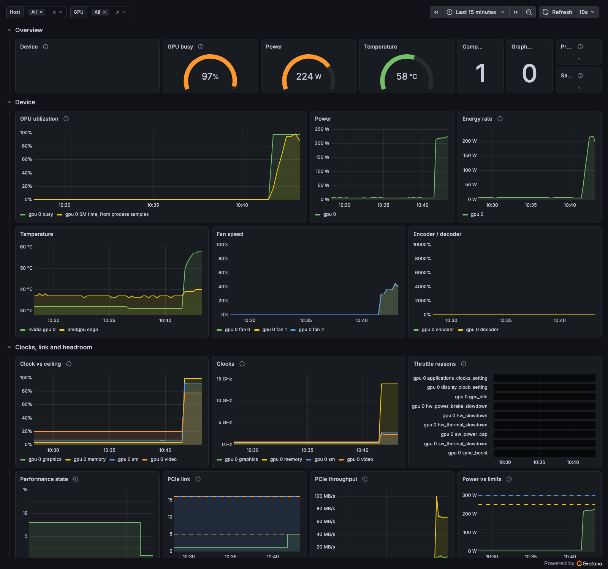

# gpu-watch, on yeet

<p align="center">
  
  
  
  
  
  
  <a href="https://github.com/yeet-src/gpu-watch/actions/workflows/kernel-matrix.yml"></a>
  <a href="https://discord.gg/JxVseaAVAU"></a>
</p>



## Getting started

On the GPU host, with the NVIDIA driver loaded:

```sh
curl -fsSL https://yeet.cx | sh
yeet login
```

```sh
git clone https://github.com/yeet-src/gpu-watch
cd gpu-watch
make up
```

That builds the probe and starts the service on `:9480`. The compiler
comes from yeet's vendored static toolchain, fetched once into
`~/.cache/yeet`, so nothing else needs installing.

```sh
make snapshot    # every section, as a table
make top         # nvidia-smi that updates in place; ctrl-c to leave
make down        # stop and remove the service
```

Or skip the clone: each release carries `gpu-watch.tar.gz`, the built
probe included, and `yeet service import` takes a URL:

```sh
yeet service import https://github.com/yeet-src/gpu-watch/releases/latest/download/gpu-watch.tar.gz --now
```

## Usage

Everything a host's NVIDIA GPUs will tell you, from one service, on
whichever interface you are holding. The device view is NVML's, with
the parts `nvidia-smi` shows and the parts it does not chart: each
clock against its ceiling, *why* the clocks are held down, the
P-state, the PCIe link as negotiated, power against its enforced
limit, ECC. Under that, a scoped set of kprobes on the driver's entry
points answers the question NVML cannot: which process is talking to
the GPU, how often, and how long each call takes.

**Ask for a section, get a table.** A section is a word; every
interface takes a comma list and defaults to all of them.

```
$ curl -s 'localhost:9480/gpu?fields=device,thermal,clocks&format=table'
GPU 0  NVIDIA GeForce RTX 5070
  uuid           GPU-88379e65-7706-b4fb-5e78-ae338fd37ab0
  state          P1, 59 C
  clocks         graphics 2842/3120 MHz, sm 2842/3120 MHz, memory 13801/14001 MHz, video 2377/3090 MHz
  throttle       none
  fans           40%, 41%, 40%
```

**Who is talking to the driver.** That is a model serving under
Ollama. The `tokio-runtime-w` row is yeet's own daemon: its NVML
reads are ioctls too, and the probe does not exempt itself.

```
$ curl -s 'localhost:9480/gpu?fields=driver' | jq -r '.driver.by_process_name[] | "\(.comm)\t\(.rm_ioctls) rm ioctls\t\(.uvm_ioctls) uvm ioctls"'
tokio-runtime-w 22457 rm ioctls     0 uvm ioctls
ollama            567 rm ioctls   270 uvm ioctls
nvidia-smi         52 rm ioctls     4 uvm ioctls
```

**JSON, Markdown, a stream, Prometheus.** One read, rendered however
the caller wants it.

```sh
curl -s 'localhost:9480/gpu?fields=power,thermal&gpu=0' | jq         # JSON, one device
curl -s 'localhost:9480/gpu?format=md'                               # Markdown; /llms.txt is the same page
curl -sN 'localhost:9480/gpu?watch=1s&fields=utilization,clocks'     # a line of JSON per second until ctrl-c
curl -s 'localhost:9480/metrics?fields=power,thermal'                # Prometheus, the families follow the sections
curl -s localhost:9480/sections | jq                                 # what fields= accepts
```

**A terminal.** `yeet dial ws://localhost:9480/top`, which is what
`make top` runs.

**An agent.** The service is a Model Context Protocol server, and
`yeet dial` is the whole client. For Claude Code:

```sh
claude mcp add gpu-watch -- yeet dial ws://localhost:9480/mcp
```

From a laptop that has no yeet, over ssh to the GPU host:

```sh
claude mcp add gpu-watch -- ssh gpu-host yeet dial ws://127.0.0.1:9480/mcp
```

Then ask it why the training run is slow. Its tools are
`gpu_snapshot(fields, gpu)`, `gpu_watch(seconds, interval_ms, gpu)`
for a bounded window with the range each signal moved through and
every throttle reason seen, `graph_query(query)` for anything else in
yeet's system graph (processes, mounts, block devices, cgroups,
network), and `graph_type(name)` to discover the schema. The resource
`gpu://overview` is the Markdown page.

**What it finds.**

- *A job is slow and the GPU is idle.* `utilization` low, `clocks` at
  the floor, `driver` showing the process's ioctl rate at a trickle:
  the GPU is waiting on the host. `graph_query` reaches the process's
  CPU time, its open files and the block devices in the same breath.
- *A job is slow and the GPU is busy.* `throttle` names it: a power
  cap, a thermal slowdown, a hardware brake. `clocks` shows how far
  below the ceiling, `power` shows draw pinned at the enforced limit.
- *Memory is gone and nothing is running.* `processes` lists the
  contexts NVML knows; `holders` lists everyone with the device node
  open, which is where the notebook kernel that never released its
  context shows up.
- *The link is wrong.* `pcie` stuck below the slot's generation or
  width under load is a riser or a slot; `pcie_replays_total` rising
  is a bad cable.
- *Something is hammering the driver.* `driver` by escape number says
  what: a storm of `rm_control` from a process that polls, a `uvm`
  fault rate that means the working set does not fit.

## Options

```sh
make up PORT=9490            # serve everything on another port
make pack                    # gpu-watch.tar.gz: `yeet service import` it on any host
```

Selection works the same everywhere. A **section** is a word; every
interface takes a comma list of them and defaults to all:

| section | what |
| --- | --- |
| `device` | index, UUID, product name, board id |
| `power` | draw, energy since driver load, the limits the draw is held under |
| `thermal` | temperature, fans, performance state, throttle reasons |
| `utilization` | share of the window a kernel ran, and the memory controller was busy |
| `memory` | framebuffer total, used, free, reserved by the driver |
| `clocks` | graphics, SM, memory and video clocks against their ceilings |
| `pcie` | negotiated link vs the slot's maximum, replays, throughput |
| `ecc` | mode and error counts; null on cards without ECC |
| `processes` | compute and graphics contexts joined with `/proc` |
| `driver` | kprobe totals: ioctls into the driver by process, by escape, by node; the daemon's own NVML reads show as `tokio-runtime-w` |
| `holders` | every process with a GPU device node open, from the fd tables |

| route | parameters |
| --- | --- |
| `GET /gpu` (also `/`) | `fields=`, `gpu=<index>`, `uuid=<a,b>`, `format=json\|md\|table`, `watch=<500ms\|2s\|1m>` for NDJSON until you hang up |
| `GET /metrics` | `fields=` picks the Prometheus families |
| `GET /llms.txt` | `fields=`; Markdown |
| `GET /sections` | what `fields=` accepts |
| `/mcp` | `yeet dial`; the tools take `fields` too |
| `/top` | `yeet dial`; `--fields` and `--interval` are the unit's args in `service.toml` |

`service.toml` is the whole service: three isolates and a web server.
`yeet service apply -f service.toml gpu-watch` rolls an edit out.

## What comes out

One read behind every interface: the graph for the device sections,
the sampler's running totals for `driver` and `holders`. On `/metrics`
the families follow the sections.

| family | source |
| --- | --- |
| `nvidia_gpu_info`, `_count` | NVML |
| `nvidia_gpu_power_watts`, `_energy_joules_total`, `_power_limit_watts{limit}` | NVML; the enforced limit is the one the driver actually holds |
| `nvidia_gpu_temperature_celsius`, `_fan_speed_ratio{fan}`, `_performance_state`, `_throttle_reason{reason}` | NVML; throttle is a 0/1 row per reason, so `max by (gpu)` is "is it throttling" |
| `nvidia_gpu_utilization_ratio`, `_memory_utilization_ratio` | NVML; memory high with SM low is a bandwidth-bound workload |
| `nvidia_gpu_memory_{total,used,free,reserved}_bytes` | NVML |
| `nvidia_gpu_clock_hertz{domain}`, `_clock_max_hertz`, `_clock_application_hertz` | NVML; `clock / clock_max` is headroom |
| `nvidia_gpu_pcie_link_{generation,width,max_generation,max_width}`, `_pcie_replays_total`, `_pcie_throughput_bytes_per_second{direction}` | NVML; the link drops to gen 1 at idle and must renegotiate under load |
| `nvidia_gpu_ecc_enabled`, `_ecc_pending_enabled`, `_ecc_errors_total{scope,kind}` | NVML; absent on cards without ECC |
| `nvidia_gpu_compute_processes`, `_graphics_processes`, `nvidia_gpu_process_*` | NVML contexts joined with `/proc`: memory held, RSS, threads, CPU time |
| `nvidia_rm_*`, `nvidia_uvm_*`, `drm_*`, `nvidia_process_*`, `drm_process_*` | kprobes: ioctls into the resource manager, unified memory and DRM, by process name, by escape number, by device node, by pid |
| `gpu_device_node_holders`, `gpu_device_node_holder_info` | fd tables: who has `/dev/nvidia*` or `/dev/dri/*` open, context or not |
| `gpu_kernel_probe_up`, `gpu_exporter_*` | the service itself |

A value the card does not report is left out, never printed as 0.
Per-pid kernel counters cover pids seen in the last five minutes and go
stale with them, so the series set stays bounded on a host that runs
many short CUDA jobs.

## Dashboard

`dashboard.json` is the dashboard at the top. Import it in Grafana
(Dashboards, New, Import) and pick your Prometheus datasource; the
instance picker lists every host scraping this service. A scrape config:

```yaml
scrape_configs:
  - job_name: gpu-watch
    static_configs:
      - targets: ["myhost:9480"]
```

## Differences from nvidia-smi and dcgm-exporter

- **It is one service, not a stack.** No DCGM, no exporter binary, no
  container. The daemon reads NVML and runs the probe; the service is
  a few scripts.
- **It sees the host side.** NVML names a context's pid and memory;
  the probes see every ioctl that pid makes and how long the driver
  took, and the fd scan sees processes NVML has no context for.
- **It is selectable and streamable.** `?fields=` and `?watch=` on the
  web, the same words as MCP tool arguments; `nvidia-smi` prints one
  page.
- **It is for agents as much as people.** MCP and `/llms.txt` are
  first-class, with the same vocabulary as the dashboard.
- **NVIDIA only, for the device view.** The graph's `nvidia` context is
  NVML. The DRM probe and the fd scan cover every GPU driver, and
  temperatures from `amdgpu`, `nouveau` and `i915` come through hwmon
  on the dashboard, but clocks, memory and the rest are NVML's.
- **The probe needs the symbols.** The NVIDIA module is not BTF-typed,
  so these are kprobes by name. A driver release that renames an entry
  point fails the probe, `gpu_kernel_probe_up` goes to 0 with the
  reason in a comment, and every NVML family still comes through.

## Read more

[yeet.cx/blog](https://yeet.cx/blog) has the series this grew out of,
starting with
[Nobody Is Listening on Port 8125](https://yeet.cx/blog/nobody-is-listening-on-8125)
on how a yeet service reads the wire.
